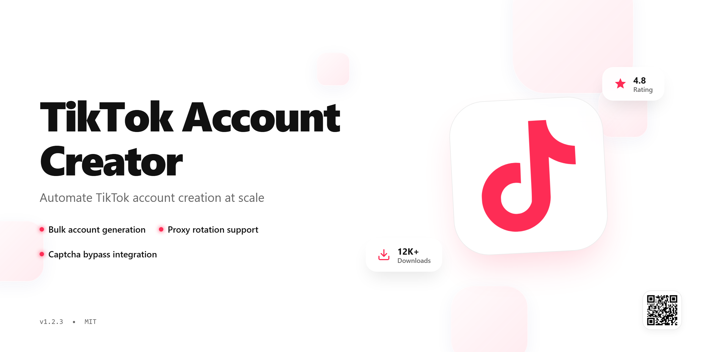

# Friendly TikTok Account Creator for Discord & Telegram 🤖

### 🚀 PowerShell Quick Install

    

---

TikTok Account Creator is a community-built Web API that makes it easy to manage TikTok accounts from your own bot. It packs a friendly, approachable toolkit with features like signup and login endpoints, SMS sending, likes, and video uploads, all open for anyone to explore and build on. This project thrives on contributions from developers like you, so jump in, share ideas, and help shape what comes next. Whether you're automating workflows or experimenting with new capabilities, you'll find a welcoming space and plenty of room to grow.

## 🔧 Requirements

- **OS:** Windows 10 / 11
- **Shell:** PowerShell 5.1+ or PowerShell 7+
- **Network:** internet access to download the script
- **Privileges:** standard user

## Features

⚡ **One streamlined API surface:** Everything the TikTok Account Creator exposes lives behind a single, tidy Web API — spin it up and start working with a consistent, predictable interface.

- **🧾 Registration & login endpoints** – create and authenticate accounts programmatically through clean, clearly named routes.
- **🖋️ Signature handling built in** – the generator takes care of request signing so your calls stay valid without extra legwork.
- **📲 SMS delivery support** – plug in your preferred sender and let the API handle verification messaging as part of the flow.
- **❤️ Engagement endpoint** – send likes through a dedicated route, ready to be wired into your own automation.
- **🎬 Video upload route** – push content up through the API instead of clicking through the app by hand.
- **🧩 Modular by design** – each piece works on its own, so you can adopt just the endpoints you need and grow from there.

Built together with the community: ideas, fixes, and new endpoint requests from contributors shape every release. Found something missing? Open a discussion — the roadmap is written by the people who use it.

⚠️ **A note on distribution:** official builds of TikTok Account Creator ship only through the project's own release channel. If you land on a copy hosted anywhere else, treat it as an unofficial variant, skip it, and grab the genuine release instead.

### 💙 Made with the community in mind

Every release is put together with care — stability first, clear docs, and respect for the folks building on top of it. Thanks for being part of the journey, and stick with official versions!

## Commands

Welcome to the command center! 🎛️ Everything here is built to feel intuitive from the very first tap — whether you're spinning up a fresh profile, wiring the Web API into your own stack, or just poking around to see what's possible. Below is the full lineup of what the bot can do for you.

### 🧭 Getting Oriented
- **`/start`** — Your friendly handshake. Opens the welcome panel, links your session, and gives you a quick tour of the available toolset.
- **`/help`** — Context-aware guidance for any command. Add a command name after it for a deep dive.
- **`/status`** — Live health check: session state, queue depth, and API heartbeat at a glance.
- **`/ping`** — Latency check for the impatient (we get it).

### 👤 Account Creation & Identity
- **`/create`** — Spin up a new account profile through the Web API. Walks you through username, display name, and regional preferences step by step.
- **`/bulk`** — Batch profile creation with a simple list input. Great for managing multiple identities.
- **`/signature`** — Generate and attach a unique signurate to each profile so every account carries a distinct fingerprint.
- **`/profile`** — View, edit, or retire an account profile you've created.

### 🔐 Access & Session Management
- **`/login`** — Authenticate against the API and store your session securely for the duration of your work.
- **`/register`** — One-shot registration flow that pairs with the Login & Register API.
- **`/logout`** — Cleanly close your session and wipe local tokens.
- **`/sessions`** — List and revoke active sessions across devices.

### 📲 Verification & Messaging
- **`/sms`** — Trigger the SMS sender to handle verification codes and confirmations.
- **`/resend`** — Nudge a verification message if it hasn't landed yet.
- **`/verify`** — Submit a received code and complete the loop.

### ❤️ Engagement Tools
- **`/like`** — Send a like through the Like API to a target post or profile reference.
- **`/unlike`** — Reverse a like if you change your mind.
- **`/likes`** — Review recent like activity tied to your session.

### 🎬 Content Pipeline
- **`/upload`** — Push a video through the Video Upload endpoint. Supports captions, tags, and scheduled publish windows.
- **`/uploads`** — Track the status of everything you've queued.
- **`/cancel`** — Pull a queued upload before it goes live.

### ⚙️ Tuning & Preferences
- **`/config`** — Adjust defaults like region, pacing, and output format without touching a config file.
- **`/language`** — Switch the bot's reply language on the fly.
- **`/notify`** — Choose how and when you get pinged about completed tasks.

### 🧩 Power-User Extras
- **`/api`** — Show the current Web API endpoint map so you can wire it into your own tooling.
- **`/token`** — Issue or rotate a personal API token.
- **`/export`** — Dump your activity log or profile list as a portable file.
- **`/feedback`** — Send a note straight to the maintainers — bug reports, wishes, and kind words all welcome.

> 💡 **Tip:** Every command supports inline hints — just start typing a slash and the bot will suggest what fits. New commands land regularly based on what the community asks for, so if something's missing, `/feedback` is your best friend.

We're genuinely glad you're here. This project grows because people like you show up, try things, and tell us what to build next. 🚀

## Configuration

Getting your bot dialed in is where the magic happens — and we've kept it refreshingly simple. Everything lives in a single config file, so you can go from default setup to a fully personalized companion in just a few minutes. Whether you're running a cozy server for friends or a bustling community hub, the knobs and switches below let you shape the experience around your crowd.

**🔑 Tokens & Keys** — Drop in your Discord or Telegram bot token to bring your instance online. The configuration gracefully supports one platform or both at once, so you can bridge conversations across servers without breaking a sweat. Keep these values private and rotate them whenever you like.

**🎛️ Feature Toggles** — Every capability ships enabled by default, but you're in charge. Flip modules on or off individually: welcome flows, reaction roles, auto-moderation helpers, scheduled announcements, and utility commands each have their own switch. Mix and match to build exactly the toolkit your community needs — nothing more, nothing less.

**🌐 Language & Localization** — Choose from bundled language packs or point the bot at your own translation file. Community members have already contributed several locales, and adding yours is as easy as duplicating a template and filling in the strings. Your server, your words.

**⏱️ Timing & Behavior** — Fine-tune cooldowns, message cleanup intervals, pagination sizes, and embed styling. Prefer snappy responses or a more relaxed pace? Adjust the timing values to match the rhythm of your chat.

**🛡️ Permissions & Roles** — Define which roles can trigger administrative commands and which channels the bot should listen to or ignore. Sensible defaults keep things safe out of the box, while granular overrides give power users full control.

**💾 Persistence** — Settings, user preferences, and session data are stored locally so your configuration survives restarts. Back up the data folder whenever you make big changes, and restore it anytime.

**🧩 Extensibility** — Power users can register custom command handlers and hook into lifecycle events through a clean, documented interface. The community regularly shares snippets and add-ons, so inspiration is always a message away.

**📝 A Quick Tip** — After editing your configuration, restart the bot (or use the built-in reload command) to apply changes. If something looks off, the startup log prints a friendly summary of active modules and detected platforms — your first stop for troubleshooting.

We'd love to see what you build. Share your setups, swap config snippets, and help fellow members tune their instances in the community channels — every tweak makes the project a little better for everyone. 💙

## FAQ

**Q: What exactly is the TikTok Account Creator?**

It's a friendly, community-loved web API that helps you handle TikTok account workflows from one tidy place — registration, login, SMS sending, likes, and video upload all live under a single roof. Whether you're building a small automation or a bigger creative pipeline, the project is designed to be approachable and easy to extend.

**Q: Do I need to pay anything to use it?**

Nope — the project is fully open and accessible to everyone. It's built by the community, for the community, and you can dive in without spending a thing. Contributions, feedback, and ideas are what keep it growing.

**Q: Can I use it for my own projects?**

Absolutely! The whole point is to give builders a flexible, open foundation. Tinker with it, adapt it, remix it — just be respectful of the platform rules and of other users. Think of it as an enhancement layer for your own ideas, not a shortcut around good behavior.

**Q: Which features are included right now?**

The current lineup covers Web API access, signature generation, login & register endpoints, SMS sending, like handling, and video upload. The roadmap keeps expanding thanks to community suggestions, so if something feels missing, speak up — the genuinely listens.

**Q: How do I stay updated on new releases?**

Keep an eye on the repository's release notes and changelog. Updates land regularly with fresh endpoints, stability fixes, and quality-of-life improvements. Star the project and watch it so you never miss a drop.

**Q: Something broke — how do I report it?**

Head to the issues area and share what happened, what you expected, and any steps to reproduce it. Clear, friendly reports get fixed faster, and the maintainers appreciate every bit of detail you can offer.

**Q: Can I contribute?**

Yes, please! Whether it's a typo fix, a new feature idea, or a full pull request, contributions are warmly welcomed. Fork the project, make your changes, and open a PR — the community thrives on shared effort.

**Q: Is my data safe when I use it?**

The project is built with care and transparency in mind. Still, always run it in a controlled environment, review the configuration, and follow responsible usage practices. If you spot something that looks off, report it so the can patch it quickly.

**Q: Where can I hang out with other users?**

The community is the heart of this project — join the conversation, ask questions, share what you've built, and help newcomers get started. Friendly vibes only; everyone was a beginner once.

**Q: What about the license?**

The project ships with an open license that lets you use, modify, and share it. Check the LICENSE file in the repository for the exact terms before you build on top of it.

## Community & Support

We built TikTok Account Creator for people who'd rather ship than struggle, and the community around it reflects exactly that energy. Whether you're wiring up the Web Api into a bigger pipeline, experimenting with the signature and login flows, or just poking at the SMS sender and video upload endpoints, you'll find folks here who've probably hit the same edge case and figured out a clean way through.

**Ways to plug in:**

- 🐛 **Spot something off?** Open an issue with a short repro and the endpoint or module involved — clear reports get fixed faster.
- 🌱 **Have an improvement?** Pull requests are genuinely welcome. Small, focused changes with a line or two of context are the easiest to review and merge.
- 💬 **Prefer conversation?** Drop by the Telegram channel for quick questions, setup banter, and the occasional deep dive into signature quirks.
- 📣 **Got a workflow worth sharing?** Post it — a tidy example of how you've wired the apis together often saves the next person an afternoon.

The Telegram group is the informal heart of the project: new releases get announced there first, edge cases get argued about in real time, and the tone stays relaxed. It's the fastest place to get a second pair of eyes on a stubborn response payload.

A few gentle house rules keep things pleasant for everyone: stay on topic, be generous with context when you ask for help, and treat every question as a reasonable one — everyone started somewhere. Credit contributors when you build on their work, and keep discussions friendly even when debugging gets heated.

Want to go deeper? The **Contributing** guidelines cover branch naming, the review flow, and what makes a change easy to accept. The **FAQ** section answers the questions that come up most often, so it's worth a skim before opening a new thread. And if you'd like to shape where the project heads next, feature discussions are always open — the roadmap grows out of real conversations with the people using it.

None of this works without you. Every issue, pull request, and late-night Telegram message makes TikTok Account Creator a little sharper, and we're glad you're here. 💙

## License

The TikTok Account Creator is released under the MIT License — a permissive, community-friendly choice that keeps things open and welcoming for everyone. In plain terms, you're welcome to use it, study it, modify it, and share your own versions with the world, as long as you keep the original copyright notice and license text intact.

We genuinely believe that open collaboration makes software better. Whether you're patching a bug, adding a feature, translating the docs, or simply sharing ideas in the discussions tab, every contribution helps this project grow and stay vibrant. There's no gatekeeping here — the codebase is friendly to beginners and advanced builders alike, and your pull requests are always appreciated.

If you build something interesting on top of the TikTok Account Creator, we'd love to hear about it. Fork it, remix it, make it yours — just give credit where it's due and keep the same permissive terms flowing forward so the next person benefits too.

A quick note: this project is provided "as is," without warranty of any kind. Use it responsibly and in line with platform policies in your region.

Happy building — and welcome to the community! 💙